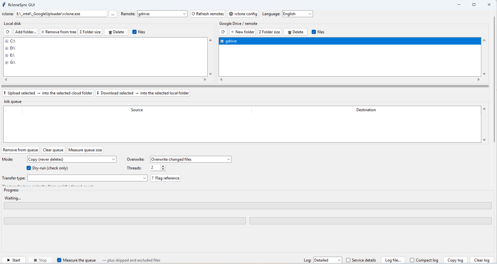

# RcloneSync GUI

*[Українською](README.md) · English*

A visual front end for [rclone](https://rclone.org) and Google Drive: two trees
side by side, a job queue, live progress, uploads and downloads.
Python + tkinter, no pip dependencies at all.



The interface speaks both languages: pick **Language** in the top bar, the
choice is remembered.

The program runs on your computer only and collects nothing about you — the
details are in the [privacy policy](PRIVACY.en.md).

## What you need

Two third-party things, both free:

* **Python 3.9 or newer** — the program itself is written in it
* **rclone** — it does the transfers; **it is not in this repository**,
  it is an 85 MB third-party binary

Below is how to install both from scratch. If you already have them, go
straight to [authorising with Google Drive](#authorising-with-google-drive).

## Installing Python

The simplest way is the installer from
[python.org/downloads](https://www.python.org/downloads/), the **Download
Python** button at the top of the page.

On the **first** installer screen tick **«Add python.exe to PATH»** — it is
at the bottom and is cleared by default. Without it the `python` command will
not work in a console. Then **Install Now**; nothing else needs touching:
tkinter, which draws the program's window, is part of the standard set and is
installed along with it.

With `winget` instead:

```
winget install --id Python.Python.3.13
```

The version is at the end of the identifier — put a newer one there if it has
been released.

To check, open a command prompt (Win+R → `cmd`) and type:

```
python --version
```

It should answer `Python 3.13.x` or similar. If the Microsoft Store opens
instead, Windows did not find Python and offered its own shortcut: either the
PATH box was not ticked, or the console was opened before the installation
(closing and reopening it is enough).

## Installing rclone

The program looks for it in this order: next to the script → in `PATH` → in
the usual installation folders. So any of these will do.

**Option 1, one command:**

```
winget install Rclone.Rclone
```

Close the console and open it again afterwards, otherwise it does not yet know
about the new program.

**Option 2, portable** — installing nothing into the system:

1. Open [rclone.org/downloads](https://rclone.org/downloads/)
2. Take **Windows · AMD64 · 64 Bit** (for an ordinary PC; ARM64 is only for
   tablets and laptops with ARM processors)
3. Unpack the zip and put `rclone.exe` into the same folder as
   `Rclone_sync_gui.py`

The program will pick it up by itself, no path to configure.

It is worth checking the downloaded archive against `SHA256SUMS` on the site.

To check:

```
rclone version
```

If it answers `rclone v1.7x.x`, you are done. If it says the command is not
recognised while you put `rclone.exe` next to the script, that is normal: from
an arbitrary folder the console does not see it, but the program does.

## Getting the program itself

Without git: on the repository page use the green **Code** button →
**Download ZIP**, then unpack it anywhere. Updates will have to be downloaded
the same way by hand.

With git:

```
git clone https://github.com/vasiliygts/GoogleDrive-rclone-uploader-downloader-GUI.git
```

## Authorising with Google Drive

A one-off procedure, done **before** the first run of the program:

```
rclone config
```

Answers for the wizard: `n` → name `gdrive` → storage `drive` → leave
`client_id` and `client_secret` empty → scope `1` (full access) →
`service_account_file` empty → advanced `n` → auto config `y`.

A browser opens: pick the account → **Advanced** → **Go to rclone (unsafe)** →
allow. The `Waiting for code...` line in the console can be ignored — rclone
collects the code itself through a local web server on `127.0.0.1:53682`. Then
`n` (not a Shared Drive) → `y` → `q`.

To check: `rclone lsd gdrive:` should list the folders from Drive.

The token lands in `rclone.conf` (`rclone config file` prints the path).
**It is the key to the account — never publish it or put it in a
repository.** It is already in `.gitignore`.

> rclone's shared `client_id` is being retired during 2026. To keep uploads
> working it is worth creating your own:
> [rclone.org/drive/#making-your-own-client-id](https://rclone.org/drive/#making-your-own-client-id).
> The client type is **Desktop app**, and the consent screen must be
> **published**, otherwise Google revokes the token every 7 days.

## Running it

From the program's folder:

```
python Rclone_sync_gui.py
```

A black console opens together with the window — that way you can see it if
the program fails to start and prints an error. Once everything works the
console is in the way: run it through `pythonw` and it does not appear.

```
pythonw Rclone_sync_gui.py
```

To avoid typing that every time, make a shortcut: right-click
`Rclone_sync_gui.py` → «Create shortcut», then in the shortcut's properties
prepend the path to `pythonw.exe` in the «Target» field. `where pythonw` shows
where it lives.

## How to use it

1. Select files/folders on the left (Ctrl+click for several)
2. Select the **parent** destination folder on the right
3. **⬆ Upload** — the pair goes into the queue
4. **▶ Start**

Step 3 transfers nothing, it only queues. Start begins the transfer.

The «Destination» column shows the resulting path — it is worth checking
against it. Selecting a folder on the right with the same name as the source
gives a nested duplicate (`_BOOKS/BOOKS/BOOKS`); select the parent instead.

Leave **Dry-run** on for the first run — it shows what would be done without
changing anything. Especially before `sync` mode.

### How much is selected

Under each tree there is a summary of the selected rows:

```
Selected: 3 (1 folders, 2 files)   ·   3.9 KB   ·   size unknown: 1 — «Σ Folder size» counts them
```

File sizes are known straight away. Folders are not counted until measured:
Google Drive does not report a folder's size while browsing, it has to be
walked recursively. The **Σ Folder size** button does that for the selected
folders, after which they count towards the total.

### Deleting

The **🗑 Delete** button on both panes removes what is selected — with a
confirmation and a list of what will disappear. Folders go together with their
contents.

Nothing is erased for good:

| From | To | Kept for |
|---|---|---|
| local disk | Windows Recycle Bin | until you empty it |
| Google Drive | Drive trash | 30 days |

Locally this uses the same system call as Explorer (`SHFileOperationW` with
`FOF_ALLOWUNDO`), in the cloud the `purge` and `deletefile` commands, which
respect `--drive-use-trash`. A drive root cannot be deleted.

### Transfer type

File size decides which settings give the better speed. The threshold is
8 MiB: smaller files go in a single request, larger ones are cut into chunks
of `--drive-chunk-size`, and every chunk is a separate API request.

| Transfer type | Threads | What for |
|---|---|---|
| Large files (100 MB – 1 GB) | 2 | big chunks, fewer requests per file |
| Small files (a few MB at most) | 12 | the bottleneck is the API, parallelism helps |
| Mixed · one pass — simpler | 4 | averaged set, the queue runs once |
| Mixed · two passes — faster | — | Start runs the queue twice by itself |
| Separately · small only (≤64 MB) | 12 | one half of «two passes», on its own |
| Separately · large only (≥64 MB) | 2 | the other half, on its own |

### Which of the two mixed types to take

| | one pass | two passes |
|---|---|---|
| Files of similar size | ✔ | pointless |
| Both hundred-MB videos and lots of small files | loses | ✔ |
| Very many files in the tree | ✔ | the tree is scanned twice |
| A small one-off transfer | ✔ | no visible difference |

In short: two passes win where the size spread is large and there is something
to transfer. If a folder holds tens of thousands of files, double scanning
eats more than the optimisation gives — then one pass.

The transfer type sets both the flags and the thread count. An explanation
appears under the list, and the **? Flag reference** button opens a
description of the switches themselves.

On folders with mixed contents two passes are noticeably faster than one. The
flags and the thread count are shared by the whole queue, so a single run
cannot use different settings for different files — that is exactly what the
two passes are for.

You do not have to do it by hand. The **«Mixed · two passes — faster»** type
takes care of it: build the queue once, press Start, and the program runs it
twice with the right settings. The button then reads `▶ Start (2 passes)`, and
the flag and thread fields are disabled because the passes set them.

The progress line shows which pass is running:

```
[2/4] pass 2 · large ⬆ E:\Photos → gdrive:Backup/Photos
```

The counter is cumulative: two jobs in the queue × two passes = `/4`.

If you need control between the passes, or only one half of them, the same
passes are in the list as **«Separately · small only»** and **«Separately ·
large only»**. Order does not matter, the size filters pick what belongs.

The «Extra flags» field stays yours: the transfer type only fills it in, and
you can edit it by hand for a particular case.

### Small things

* `Σ Folder size` — measures the selected folder on demand (Drive does not
  report it in listings, a recursive walk is needed)
* file sizes are shown in the row label, both in the cloud and locally
* `Add folder…` pins an arbitrary folder as a top-level row of the left tree,
  so you do not have to walk to it from the drive root every time;
  `✕ Remove from tree` removes that row while the folder stays on disk
  (the other button, `🗑 Delete`, is the one that deletes from disk)
* `⟳` or **F5** — re-read the selected folder without collapsing the tree
* the grey strip under the trees is draggable, the whole form scrolls
* the window size, tree height and splitter position are remembered; if a
  saved position would end up off screen (after unplugging a second monitor,
  for example) the window comes back to a visible place
* the log can be copied: Ctrl+C, Ctrl+A, right-click, or the button below
* Ctrl+C/V/X/A work on a Cyrillic keyboard layout too
* folders with `\` in the name cannot be opened by rclone on Windows — the
  program says so right away, such folders need renaming in Google Drive

### Progress

There are three bars, because one does not describe a mixed queue:

```
████████▏
File    30.0%   240.0 MB / 800.0 MB   ·   holiday_2026.mp4   (+1)

██▍                            ████▎
Size     7.8%  240 MB / 3.0 GB   Files   16.9%   204 / 1205
          · job 23%                      · job 17%

6.1 MB/s (avg 5.8 MB/s) · ETA 15m 00s · checked 4 · errors 0
Queue: job 1 of 2 · actually transferred 200 files, 240.0 MB
```

The top bar is about the file going right now and takes the full width. When
there are several threads it shows the largest of them, because that is what
decides how long the wait is; how many files are going alongside is in
brackets, and their names are on the line below.

The two lower bars are about the whole queue, half the width each. By count it
can be nearly everything while by volume it is a fifth, because one large file
weighs more than hundreds of small ones. With a single bar the picture would
be either too optimistic or too gloomy. Next to the queue percentage stands
the percentage of the job that is running.

The **Measure the queue** checkbox (on by default) runs `rclone size` over
every job before the transfer, so from the first second the bars show a share
of the whole queue rather than of what rclone has walked so far. The current
job stays in brackets next to it. Clearing the checkbox avoids that extra
walk — the bars then show the current job only, its denominator grows while
rclone walks, and the percentage jumps about in the first seconds.

Measuring runs in parallel with the transfer and re-reads the queue, so
folders added on the fly are counted: the denominator grows and the percentage
drops accordingly. In two-pass mode each pass is measured with its own size
filter, so the sum matches the real volume.

A job where everything was already in place counts towards the bar in full —
by its measured size, not by what was transferred. Otherwise the bar would
never reach the end. How much actually went over the network is in the
«Queue» line.

### Log

Above the log itself there is a **Level** with three values; next to it stands
what the chosen level shows.

| Level | What it shows |
|---|---|
| Brief | only the start of each job and its summary |
| Normal | plus a line per transferred file: name, size, duration |
| Detailed | plus skipped and excluded files — you see what was left alone |

The duration appears only where a file took longer than a second. The level is
taken at the start of a run — switching while it works applies next time.

The job summary names the reason:

* `4 match by name and size` — that many files are already in the destination.
  If the modification times differ, rclone also compares the checksum, and
  with an equal checksum it still does not overwrite the file
* `no files >64 MB` — the bound comes from the pass's flags
* `empty folder`

**Service details** is a checkbox. While it is clear, the log shows neither
the rclone command nor the mode's set of flags. Ticked, it shows them; that is
needed only when something went wrong and you need to see what rclone was
actually run with.

**Log file…** picks a file to write everything into, regardless of the level
and without trimming. Until a file is chosen the log is simply shown in the
window. Clicking the button again (it then reads **Stop writing to file**)
turns writing off. The window keeps the last 5000 lines, the file keeps all.

### Modes

| Mode | Action |
|---|---|
| `copy` | adds and updates, deletes nothing |
| `sync` | mirror — **deletes** everything in the destination that is not in the source |
| `move` | transfers and deletes the source |

Settings are stored in `%APPDATA%\RcloneSyncGUI\settings.json`. If the panel
layout ever gets messed up, that file can be deleted.

## Finding large files

`find_big.ps1` is a separate script, outside the program. It finds the largest
files in a storage and lists them sorted. Handy when you need to understand
what is taking up the space.

It takes three arguments in order: **storage**, **minimum size** and,
optionally, **a file to save into**.

From cmd:

```
powershell -ExecutionPolicy Bypass -File find_big.ps1 gdrivepc: 5000M
```

From PowerShell:

```
.\find_big.ps1 gdrivepc: 5000M
```

Examples:

```
.\find_big.ps1 gdrive: 1G                      # the largest on «My Drive»
.\find_big.ps1 gdrive: 1G big_files.txt        # the same, written to a file
.\find_big.ps1 "gdrivepc:Learning (T)" 100M    # within one folder only
.\find_big.ps1 "E:\__tmp" 500M                 # works locally too
```

The result:

```
    830,2 MB   Exam-20240121_091116-Meeting recording.mp4
     64,8 MB   Exam-20240121_091116-Meeting recording 1.mp4

Files found: 2   total 0,87 GB
```

A few notes:

* run it from the project folder — `rclone.exe` is looked for next to the
  script, otherwise in `PATH`
* the size is written without a space: `500M`, `1G`, `250k`
* protection against the 403 error is already inside (`--tpslimit`,
  `--drive-skip-shortcuts`), nothing needs adding
* **the filter does not speed up the search**: rclone walks the whole tree
  anyway and only then filters. Over the `gdrive:` root that is about a
  quarter of an hour, so when you roughly know where to look, narrow it down
  to a folder

The script's own messages are Ukrainian; it is a separate tool and the
language switch in the program does not reach it.

## If something does not start

**`python` is not found, or the Microsoft Store opens** — the «Add python.exe
to PATH» box was not ticked during installation. The quickest fix is to run
the installer again, choose **Modify** and enable it.

**The window flashed and disappeared** — the program crashed with an error,
but the console closed with it. Run it from an already open console
(`python Rclone_sync_gui.py`) and the error text stays on screen.

**No window appears at all** — a rare case where Python was installed without
tkinter. To check: `python -m tkinter` should open a small window with a
button. If it does not, reinstall Python from python.org.

**The program says rclone was not found** — either put `rclone.exe` next to
`Rclone_sync_gui.py`, or point to it with the `…` button to the right of the
`rclone:` field at the top of the window.

**The Remote list is empty** — rclone is installed but Google Drive has not
been connected to it yet. That is the
[«Authorising with Google Drive»](#authorising-with-google-drive) section.

**The window opened somewhere off screen** — this happens after unplugging a
second monitor. The program brings it back to a visible place on the next
start.
