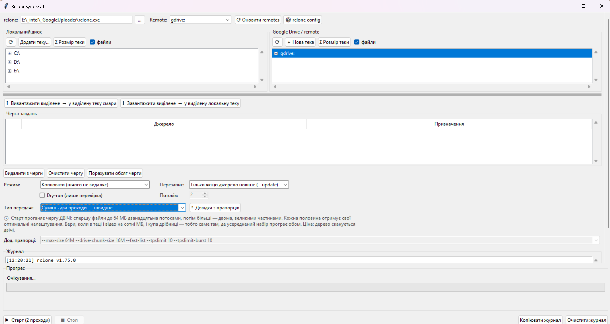

# RcloneSync GUI

Візуальна оболонка над [rclone](https://rclone.org) для Google Drive: два дерева
поруч, черга завдань, прогрес у реальному часі, вивантаження і завантаження.
Python + tkinter, без жодних pip-залежностей.



## Що потрібно

* Python 3.9+ з tkinter (у стандартному інсталяторі Windows він уже є)
* rclone — **у репозиторії його немає**, це 85 МБ стороннього бінарника

## Встановлення rclone

Програма шукає його в такому порядку: поруч зі скриптом → у `PATH` →
у типових теках встановлення. Тож підійде будь-який варіант:

```
winget install Rclone.Rclone
```

або портативно — завантажити zip з [rclone.org/downloads](https://rclone.org/downloads/),
витягнути `rclone.exe` у теку зі скриптом. Тоді нічого налаштовувати не треба,
програма підхопить його сама.

Варто звірити контрольну суму завантаженого архіву з `SHA256SUMS` на сайті.

## Авторизація в Google Drive

Разова процедура, робиться **до** першого запуску програми:

```
rclone config
```

Відповіді майстра: `n` → ім'я `gdrive` → storage `drive` → `client_id` і
`client_secret` порожні → scope `1` (повний доступ) → `service_account_file`
порожньо → advanced `n` → auto config `y`.

Відкриється браузер: обрати акаунт → **Advanced** → **Go to rclone (unsafe)** →
дозволити. Рядок `Waiting for code...` у консолі можна ігнорувати — rclone
отримає код сам, через локальний вебсервер на `127.0.0.1:53682`. Далі `n`
(не Shared Drive) → `y` → `q`.

Перевірка: `rclone lsd gdrive:` має показати список тек з Drive.

Токен лягає в `rclone.conf` (шлях покаже `rclone config file`). **Це ключ від
акаунта — його не можна публікувати чи класти в репозиторій.** Він уже
в `.gitignore`.

> Спільний `client_id` rclone виводять з експлуатації протягом 2026 року.
> Щоб заливки не перестали працювати, варто завести власний:
> [rclone.org/drive/#making-your-own-client-id](https://rclone.org/drive/#making-your-own-client-id).
> Тип клієнта — **Desktop app**, а екран згоди обов'язково треба **Publish**,
> інакше Google анулюватиме токен кожні 7 днів.

## Запуск

```
python Rclone_sync_gui.py
```

## Як користуватись

1. Зліва виділити файли/теки (Ctrl+клік — кілька)
2. Справа виділити **батьківську** теку призначення
3. **⬆ Вивантажити** — пара потрапляє в чергу
4. **▶ Старт**

Крок 3 нічого не передає, він лише ставить у чергу. Передачу запускає Старт.

Колонка «Призначення» показує підсумковий шлях — варто з нею звірятися. Якщо
виділити справа теку з тією ж назвою, що й джерело, вийде вкладений дубль
(`_BOOKS/BOOKS/BOOKS`); треба виділяти батьківську.

Перший запуск краще лишати з увімкненим **Dry-run** — він покаже, що буде
зроблено, без жодних змін. Особливо перед режимом `sync`.

### Скільки виділено

Під кожним деревом показано підсумок по виділених рядках:

```
Виділено: 3 (тек 1, файлів 2)   ·   3.9 КБ   ·   без розміру: 1 — рахує «Σ Розмір теки»
```

Розмір файлів відомий одразу. Теки в суму не входять, доки не пораховані:
Google Drive не віддає розмір теки при перегляді, його треба рахувати
рекурсивним обходом. Кнопка **Σ Розмір теки** робить це для виділених тек,
після чого вони враховуються в підсумку.

### Видалення

Кнопка **🗑 Видалити** на обох панелях прибирає виділене — з підтвердженням
і списком того, що зникне. Теки видаляються разом із вмістом.

Нічого не стирається назовсім:

| Звідки | Куди | Скільки зберігається |
|---|---|---|
| локальний диск | Кошик Windows | доки не очистиш |
| Google Drive | Кошик Drive | 30 днів |

Локально це робиться через ту саму системну функцію, що й у провіднику
(`SHFileOperationW` з `FOF_ALLOWUNDO`), у хмарі — командами `purge` і
`deletefile`, які поважають `--drive-use-trash`. Корінь диска видалити
не дасть.

### Тип передачі

Розмір файлів визначає, які налаштування дадуть кращу швидкість. Поріг —
8 МіБ: дрібніші файли йдуть одним запитом, більші ріжуться на частини по
`--drive-chunk-size`, і кожна частина це окремий запит до API.

| Тип передачі | Потоків | Для чого |
|---|---|---|
| Великі файли (100 МБ – 1 ГБ) | 2 | великі частини, менше запитів на файл |
| Дрібні файли (до кількох МБ) | 12 | вузьке місце — API, рятує паралелізм |
| Суміш · один прохід — простіше | 4 | усереднений набір, черга проходить раз |
| Суміш · два проходи — швидше | — | Старт сам проганяє чергу двічі |
| Окремо · тільки дрібні (≤64 МБ) | 12 | половина від «двох проходів», окремо |
| Окремо · тільки великі (≥64 МБ) | 2 | друга половина, окремо |

### Яку із двох сумішей брати

| | один прохід | два проходи |
|---|---|---|
| Файли схожі за розміром | ✔ | зайве |
| І відео на сотні МБ, і купа дрібниці | програє | ✔ |
| Дуже багато файлів у дереві | ✔ | дерево сканується двічі |
| Невелика разова передача | ✔ | різниці не помітно |

Коротко: два проходи виграють там, де розкид розмірів великий і є що
передавати. Якщо ж у теці десятки тисяч файлів, подвійне сканування з'їсть
більше, ніж дасть оптимізація — тоді один прохід.

Тип передачі виставляє і прапорці, і кількість потоків. Під списком
з'являється пояснення, а кнопка **? Довідка з прапорців** відкриває опис
самих ключів.

На теках зі змішаним вмістом два проходи помітно швидші за один. Прапорці
й кількість потоків спільні на всю чергу, тому один запуск не може мати різні
налаштування для різних файлів — потрібні саме два проходи.

Робити це вручну не обов'язково. Тип **«Суміш · два проходи — швидше»**
бере це на себе: черга складається один раз, далі Старт — і програма сама
проганяє її двічі з потрібними налаштуваннями. Кнопка при цьому підписана
`▶ Старт (2 проходи)`, а поля прапорців і потоків вимкнені, бо їх задають
самі проходи.

У рядку прогресу видно, який прохід іде:

```
[2/4] прохід 2 · великі ⬆ E:\Фото → gdrive:Backup/Фото
```

Лічильник рахує сумарно: два завдання в черзі × два проходи = `/4`.

Якщо потрібен контроль між проходами або лише одна їх половина — ті самі
проходи є в списку як **«Окремо · тільки дрібні»** і **«Окремо · тільки
великі»**. Порядок неважливий, фільтри за розміром самі відберуть потрібне.

Поле «Дод. прапорці» лишається вільним: тип передачі його лише заповнює,
а далі його можна правити вручну під конкретний випадок.

### Дрібниці

* `Σ Розмір теки` — рахує розмір виділеної теки на вимогу (Drive не віддає його
  у списку, потрібен рекурсивний обхід)
* розмір файлів видно в підписі рядка — і в хмарі, і локально
* `⟳` або **F5** — перечитати виділену теку, не згортаючи дерево
* сіра смужка під деревами тягнеться мишею, уся форма прокручується
* розмір вікна, висота дерев і положення роздільника запам'ятовуються;
  якщо збережена позиція опиняється поза екраном (наприклад, після
  від'єднання другого монітора), вікно повертається на видиме місце
* журнал копіюється: Ctrl+C, Ctrl+A, права кнопка або окрема кнопка внизу
* Ctrl+C/V/X/A працюють і на кириличній розкладці
* теки, де в назві є `\`, rclone на Windows відкрити не може — програма
  скаже про це одразу, такі теки треба перейменувати в Google Drive

### Прогрес

Шкал три, бо одна не описує змішану чергу:

```
████████▏
Файл    30.0%   240.0 МБ / 800.0 МБ   ·   відпустка_2026.mp4   (+1)

██▍                            ████▎
Обсяг    7.8%  240 МБ / 3.0 ГБ   Файли   16.9%   204 / 1205
          · завдання 23%                  · завдання 17%

6.1 МБ/с (сер. 5.8 МБ/с) · ETA 15хв 00с · перевірено 4 · помилок 0
Черга: завдання 1 з 2 · справді передано 200 файлів, 240.0 МБ
```

Верхня шкала — про файл, який іде зараз, і займає всю ширину. Коли потоків
кілька, вона показує найбільший із них, бо саме він визначає, скільки
чекати; скільки файлів іде поряд, написано в дужках, а їхні назви — рядком
нижче.

Дві нижні — про всю чергу, кожна в половину ширини. За кількістю може бути
майже все, а за обсягом — п'ята частина, бо один великий файл важить більше
за сотні дрібних. Якби шкала була одна, картина була б або надто
оптимістична, або надто похмура. Поряд із відсотком черги стоїть відсоток
самого завдання, яке зараз виконується.

Галочка **Міряти обсяг черги** (увімкнена) перед запуском проганяє
`rclone size` по кожному завданню, тож шкали від першої секунди показують
частку від усієї черги, а не від того, що rclone встиг обійти. У дужках
поряд лишається поточне завдання. Якщо галочку зняти, зайвого обходу не
буде — тоді шкали показують лише поточне завдання, а його знаменник
зростає під час обходу, і відсоток у перші секунди стрибає.

Обмірювання йде паралельно з передачею й перечитує чергу, тому теки,
додані на ходу, враховуються: знаменник росте, відсоток відповідно
падає. У двопрохідному режимі кожен прохід міряється своїм фільтром
за розміром, тож сума збігається з фактичним обсягом.

Завдання, де все вже було на місці, зараховується шкалі повністю — за
заміряним обсягом, а не за переданим. Інакше шкала не дійшла б до кінця.
Скільки насправді поїхало по мережі, показує рядок «Черга».

### Журнал

Над самим журналом є **Рівень** із трьома значеннями; поряд написано,
що саме обраний рівень показує.

| Рівень | Що показує |
|---|---|
| Коротко | тільки початок кожного завдання і підсумок по ньому |
| Звичайно | плюс рядок на кожен переданий файл: назва, розмір, тривалість |
| Докладно | плюс пропущені й виключені файли — видно, чого саме не чіпали |

Тривалість з'являється лише там, де файл передавався довше за секунду.
Рівень береться на початку запуску — перемикання під час роботи подіє
з наступного разу.

Підсумок завдання називає причину:

* `4 збігаються за назвою та розміром` — стільки файлів у призначенні
  вже є. Якщо час зміни різний, rclone ще й звіряє контрольну суму,
  і при однаковій сумі файл теж не перезаписує
* `нема файлів >64 МБ` — межа береться з прапорців проходу
* `порожня тека`

**Службові мітки** — галочка. Поки знята, журнал не показує ані команди
rclone, ані набору прапорців режиму. Увімкнена — показує; це потрібно
хіба що тоді, коли щось пішло не так і треба побачити, з чим саме
запускався rclone.

**Файл журналу…** — обрати файл, у який писати все підряд, без огляду на
рівень і без обрізання. Поки файл не обрано, журнал просто показується
у вікні. Повторний клік по кнопці (вона стає **Не писати у файл**)
вимикає запис. У вікні тримаються останні 5000 рядків, у файлі — усі.

### Режими

| Режим | Дія |
|---|---|
| `copy` | додає й оновлює, нічого не видаляє |
| `sync` | дзеркало — **видаляє** в призначенні все, чого немає в джерелі |
| `move` | переносить і видаляє джерело |

Налаштування зберігаються в `%APPDATA%\RcloneSyncGUI\settings.json`.
Якщо розташування панелей колись зіб'ється — цей файл можна видалити.

## Пошук великих файлів

`find_big.ps1` — окремий скрипт, поза програмою. Знаходить найбільші файли
у сховищі й показує їх відсортованими. Зручно, коли треба зрозуміти, що саме
займає місце.

Приймає три аргументи по порядку: **сховище**, **мінімальний розмір** і,
необов'язково, **файл для збереження**.

З cmd:

```
powershell -ExecutionPolicy Bypass -File find_big.ps1 gdrivepc: 5000M
```

З PowerShell:

```
.\find_big.ps1 gdrivepc: 5000M
```

Приклади:

```
.\find_big.ps1 gdrive: 1G                      # найбільші на «Моєму диску»
.\find_big.ps1 gdrive: 1G big_files.txt        # те саме, з записом у файл
.\find_big.ps1 "gdrivepc:Learning_ШАГ (T)" 100M   # лише в одній теці
.\find_big.ps1 "E:\__tmp" 500M                 # локально теж працює
```

Результат:

```
    830,2 МБ   Екзамен-20240121_091116-Запись собрания.mp4
     64,8 МБ   Екзамен-20240121_091116-Запись собрания 1.mp4

Знайдено файлів: 2   разом 0,87 ГБ
```

Кілька зауваг:

* запускати з теки проєкту — `rclone.exe` шукається поруч зі скриптом,
  інакше в `PATH`
* розмір пишеться без пробілу: `500M`, `1G`, `250k`
* захист від помилки 403 уже всередині (`--tpslimit`,
  `--drive-skip-shortcuts`), додавати нічого не треба
* **фільтр не пришвидшує пошук**: rclone однаково обходить усе дерево
  й лише потім відсіює. По кореню `gdrive:` це близько чверті години,
  тож коли приблизно відомо, де шукати, краще звузити до теки
